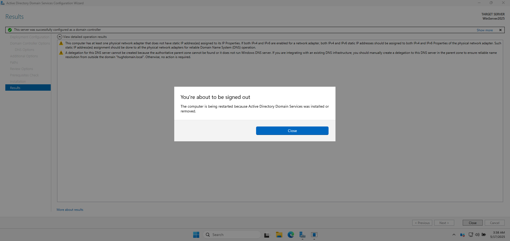
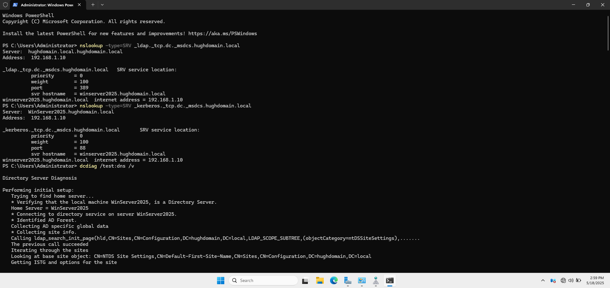
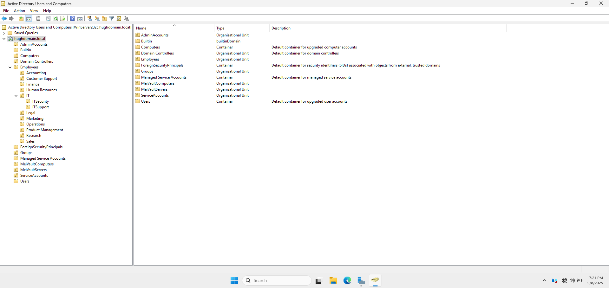
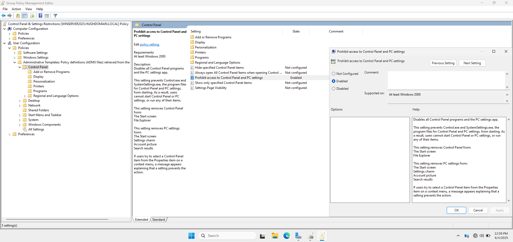
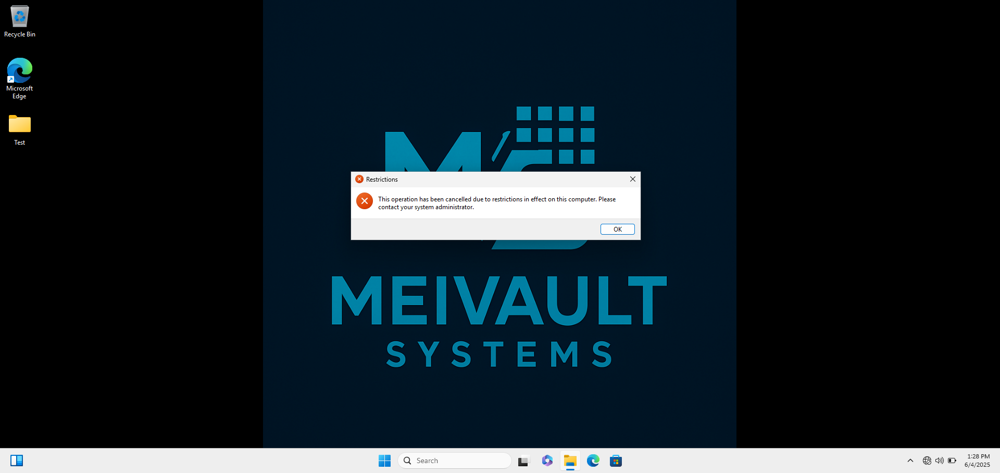
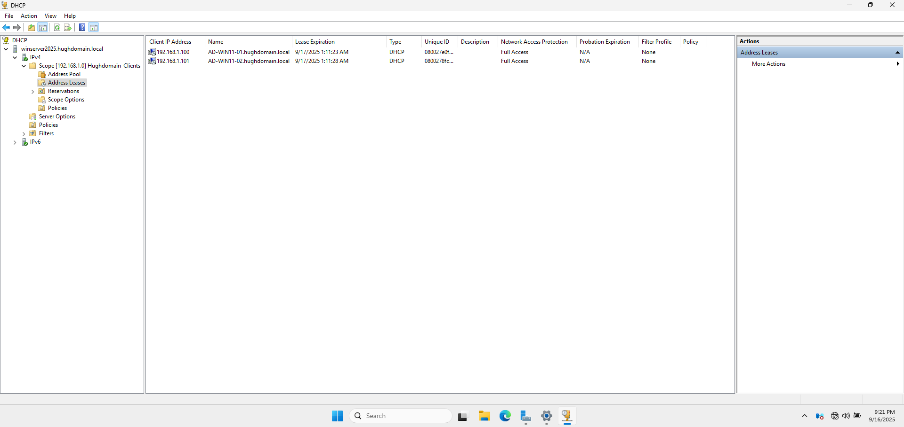

# Windows Server & Active Directory Administration Lab

A concise walkthrough for building a Windows domain in VMware and practicing users, security groups, organizational units, Group Policy, DNS, DHCP, and access troubleshooting.

> **Tutorial reference:** Adapted from Hugh Chanetsa's MIT-licensed Active Directory lab. The six screenshots are credited source examples, not captures from this repository owner's environment. The original uses VirtualBox and `192.168.1.x`; this walkthrough uses VMware and `192.168.100.x`. Follow the settings below. Full references are at the end.

## Lab environment

| Component | Example configuration |
| --- | --- |
| Hypervisor | VMware Workstation on an x64 host |
| Domain controller | `WinServer2025` — Windows Server 2025 Desktop Experience |
| Client | `AD-WIN11-01` — Windows 11 Pro or Enterprise |
| VM resources | Start with 2 vCPUs, 4 GB RAM and an 80 GB disk per VM |
| Domain | `hughdomain.local` — isolated practice domain |
| Network | Dedicated host-only VMnet, `192.168.100.0/24` |
| Server IP and DNS | `192.168.100.10` |
| Initial client IP | `192.168.100.20`; DNS `192.168.100.10` |
| DHCP pool | `192.168.100.100`–`192.168.100.200` |
| Default gateway | Blank: this isolated network has no router |

Use a subnet that does not overlap your host, VPN, or other virtual networks. Use licensed/evaluation media and a Windows 11-compatible VM with UEFI, Secure Boot capability and a virtual TPM 2.0. Windows Home cannot join this AD domain.

## 1. Prepare the VMs and server

1. Create the server and client VMs. Install Windows Server with **Desktop Experience**, Windows 11 Pro/Enterprise, and VMware Tools. Apply updates while using NAT if needed.
2. In **Edit → Virtual Network Editor**, create a dedicated **host-only** network such as `VMnet2`. Disable VMware's DHCP service **for this VMnet** and connect both VMs to it before configuring AD.
3. Rename the server `WinServer2025`, restart, then set its static IPv4 address and DNS to `192.168.100.10`, mask `255.255.255.0`, and gateway blank.
4. Check the clock and run `hostname` and `ipconfig /all` to confirm the settings.

**Why:** The domain controller needs a stable address, and clients must use its DNS service to locate AD. Keep this DHCP exercise off bridged home or work networks.

## 2. Install Active Directory

1. In **Server Manager → Manage → Add Roles and Features**, install **Active Directory Domain Services**, including its management tools.
2. Select **Promote this server to a domain controller → Add a new forest** and enter `hughdomain.local`.
3. Keep DNS Server and Global Catalog enabled, choose compatible wizard defaults, and set a unique Directory Services Restore Mode password. Resolve prerequisite errors, install, and restart.
4. Sign in as `HUGHDOMAIN\Administrator`. Open **Active Directory Users and Computers (ADUC)** and confirm that the domain appears.



*Source example: domain promotion completes and Windows announces a restart. Credit: Hugh Chanetsa, MIT License.*

## 3. Check DNS and join the client

In DNS Manager, verify the `hughdomain.local` forward zone and AD service records under `_msdcs`. From the client, configured with the initial static address in the table, run:

```powershell
nslookup WinServer2025.hughdomain.local 192.168.100.10
nslookup -type=SRV _ldap._tcp.dc._msdcs.hughdomain.local
```

Expect the server address and an LDAP service record pointing to the domain controller. Then run `sysdm.cpl` on the client, select **Computer Name → Change → Domain**, enter `hughdomain.local`, supply authorized lab administrator credentials, and restart.

For reverse DNS, create an AD-integrated IPv4 reverse zone for network ID `192.168.100`, allow secure updates, and add a PTR for `.10` pointing to `WinServer2025.hughdomain.local`. Verify:

```powershell
nslookup 192.168.100.10 192.168.100.10
```



*Source example: DNS service discovery and diagnostics. Its addresses differ from this walkthrough. Credit: Hugh Chanetsa, MIT License.*

## 4. Organize users, computers and groups

In ADUC, create a `Lab` OU with `Users`, `Workstations`, and `Groups` child OUs. Move the client into `Lab/Workstations`; keep the domain controller in its existing **Domain Controllers** OU.

| Object | Configuration |
| --- | --- |
| `alex.lee` and `sam.patel` | Standard users in `Lab/Users`; unique temporary passwords and change at first sign-in |
| `GG_IT_Staff` | Global security group in `Lab/Groups` |
| Initial membership | Alex is a member; Sam is not |

Sign in to the client as `HUGHDOMAIN\alex.lee` and run `whoami` and `whoami /groups` to confirm the identity and group membership.



*Source example: a larger OU hierarchy. This walkthrough uses the smaller `Lab` structure above. Credit: Hugh Chanetsa, MIT License.*

**Key distinction:** OUs organize objects and receive policy links; security groups grant permissions. The built-in Users and Computers containers are not OUs.

## 5. Validate group-based access

This additional exercise uses a small test share on the lab server; a production design would normally use a separate file server.

1. Create `C:\LabShares\IT` and share it as `IT`.
2. Give `GG_IT_Staff` **Change/Read** share permissions and **Modify** NTFS permissions. Remove broad access from this test folder while preserving SYSTEM and administrator access. If needed, convert inherited permissions first; change only this test folder.
3. Allow the appropriate Windows file-sharing firewall rules, keeping the firewall enabled.
4. In separate fresh client sign-ins, open `\\WinServer2025\IT`. Alex should be able to create a file; Sam should be denied.
5. Add Sam to the group, sign out/in, and retest. Remove Sam afterward and repeat with a fresh session.

**Why:** Both share and NTFS permissions must allow network access. New group membership needs a refreshed sign-in token. Record the actual identity and outcome rather than assuming access works.

## 6. Apply and test Group Policy

1. In **Group Policy Management**, create **LAB - Restrict Control Panel** and link it to `Lab/Users`.
2. Edit **User Configuration → Policies → Administrative Templates → Control Panel**. Enable **Prohibit access to Control Panel and PC settings**.
3. Keep the default Authenticated Users filtering for this exercise and confirm the link is enabled.



*Source example: the restriction's policy setting. Credit: Hugh Chanetsa, MIT License.*

As Alex on the client, use **Command Prompt**:

```bat
gpupdate /force
gpresult /scope user /r
gpresult /scope user /h "%USERPROFILE%\Desktop\gpresult.html"
control.exe
```

Sign out/in if required. Confirm the GPO appears in the **user** results and Control Panel is blocked. For a reversal test, disable the link, refresh policy, sign out/in and retry; then restore the link.



*Source example: the client displays a restriction message. Credit: Hugh Chanetsa, MIT License.*

**Why:** User settings follow the user's OU. A configured GPO alone does not prove it applied; pair `gpresult` with observed behavior.

## 7. Configure DHCP

1. Install **DHCP Server** and its management tools on the server. Complete post-install configuration and authorize it in AD. Check authorization with `Get-DhcpServerInDC` in elevated PowerShell.
2. Create and activate an IPv4 scope named **Lab Scope**, using `192.168.100.100`–`192.168.100.200` and mask `255.255.255.0`. The static server `.10` is outside this pool.
3. Set **006 DNS Servers** to `192.168.100.10` and **015 DNS Domain Name** to `hughdomain.local`. Leave **003 Router** unset on this isolated network.
4. On the client only, set both IP and DNS assignment to automatic. From its local VM console, run an elevated Command Prompt:

```bat
ipconfig /release
ipconfig /renew
ipconfig /all
```

Confirm an address in the pool, **DHCP Server** and **DNS Servers** both `192.168.100.10`, and a matching lease under **DHCP → IPv4 → Lab Scope → Address Leases**. Repeat the DNS and domain tests afterward.



*Source example: two clients have leases; this smaller lab needs one matching client lease. Credit: Hugh Chanetsa, MIT License.*

## Validation and troubleshooting

These are expected outcomes to test, not claimed results from a completed build.

| Check | Expected evidence | If it fails, inspect |
| --- | --- | --- |
| Domain sign-in | `whoami` identifies the intended domain user | Client DNS, credentials, account state and clock |
| Group access | Member allowed; nonmember denied | Fresh sign-in, group token, share and NTFS permissions |
| User policy | GPO listed in user results; Control Panel blocked | User OU, link, filtering and policy refresh |
| DNS | Forward, SRV and PTR queries return the intended records | DNS server address, zones, records and service |
| DHCP | Correct server identified and matching lease recorded | VMnet, competing DHCP, authorization and scope state |

Record your own build and observations in the [lab notes](docs/lab-notes-template.md) and [troubleshooting log](docs/troubleshooting-log-template.md). Capture settings, expected versus actual outcomes, and one issue explained as **symptom → check → fix → retest**. Exclude passwords, license keys and unrelated private information.

## References and attribution

- **Original tutorial and screenshots:** Hugh Chanetsa, [Hugh-Kumbi Active Directory Lab](https://github.com/Hugh-Kumbi/Hugh-Kumbi-Active-Directory-Lab), copyright 2025, MIT License. Source revision: [`7fe4c1f`](https://github.com/Hugh-Kumbi/Hugh-Kumbi-Active-Directory-Lab/tree/7fe4c1f9f6ff6871b2944f1d9fd18f8e8076e247).
- **Image-by-image credits and adaptation notes:** [Third-party notices](THIRD_PARTY_NOTICES.md). The original [MIT notice](licenses/Hugh-Chanetsa-MIT.txt) is retained with the reused material.
- Microsoft Learn: [Install Active Directory Domain Services](https://learn.microsoft.com/en-us/windows-server/identity/ad-ds/deploy/install-active-directory-domain-services--level-100-).
- Microsoft Learn: [Group Policy Management Console](https://learn.microsoft.com/en-us/windows-server/identity/ad-ds/manage/group-policy/group-policy-management-console).
- Microsoft Learn: [Manage DNS zones](https://learn.microsoft.com/en-us/windows-server/networking/dns/manage-dns-zones).
- Microsoft Learn: [Install and configure DHCP Server](https://learn.microsoft.com/en-us/windows-server/networking/technologies/dhcp/quickstart-install-configure-dhcp-server).
- Broadcom: [Using the Virtual Network Editor in VMware Workstation](https://knowledge.broadcom.com/external/article/339371/using-the-virtual-network-editor-in-vmwa.html).

This summary condenses the illustrated tutorial into a VMware-oriented learning guide. It simplifies the OU design, changes the subnet, and adds an access-testing exercise. Source screenshots remain unmodified and are examples to learn from; record your own captures and results as you complete the lab.
